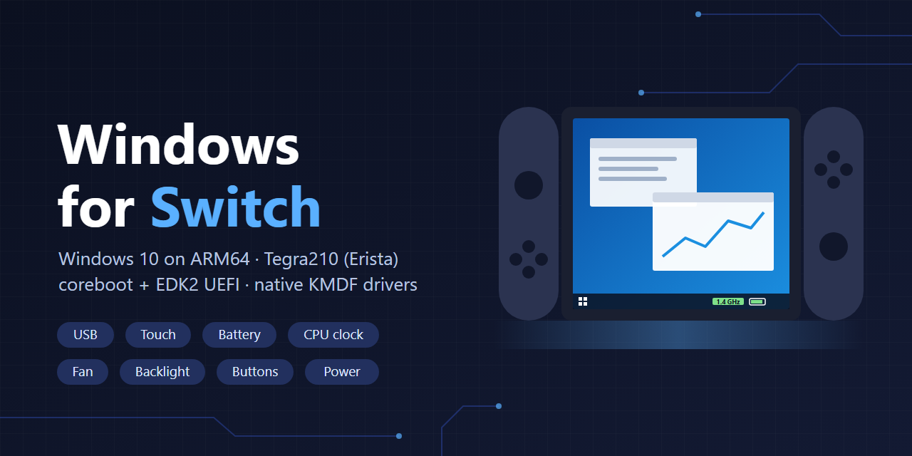

# Windows for Switch

初代 Nintendo Switch（Tegra210「Erista」）で Windows on ARM を動かすプロジェクトです。
- **対象の本体:** RCM に入れられる未対策の本体だけです。
- **Windows:** Windows 11 Arm64 22H2（build 22621）で動作を確かめています。
- **起動のしかた:** coreboot と EDK2 の UEFI を使い、microSD から起動します。

このリポジトリは、[imbushuo/NintendoSwitchPkg](https://github.com/imbushuo/NintendoSwitchPkg)（EDK2 のプラットフォームパッケージ）の続きとして作っています。元の履歴は、そのまま残しています。このリポジトリで足したものは次のとおりです。

- USB、電源、画面などを Windows に引き渡すための UEFI の変更
- Switch のハードウェア向けの Windows カーネルドライバー一式
- 立ち上げの記録

English: [README.md](README.md)

> **注意:** 実験的なものです。検証の足りない電源・クロック・画面の処理を、実機で動かします。eMMC には一切書き込みませんが、自己責任で使ってください。CPU のプロファイルを標準より上げると VDD_CPU の電圧も上がるので、これも自己責任でお願いします。

## 動いているもの

| 機能 | 実現方法 |
|---|---|
| microSD からデスクトップまで起動 | RCM → coreboot → UEFI（このパッケージ）→ SD 上の Windows Boot Manager |
| USB ホスト（HS/FS）: ハブ、キーボード、マウス、ストレージ、RTL8153 の有線 LAN | UEFI が XUSB を起動したまま引き渡し、Windows 標準の `USBXHCI` が動かす。R389 から、XUSB を起動できたときだけ DSDT の XHC0 を Windows に見せる |
| Windows の起動後の USB-C の抜き差し（機器なら 5V を出す・止める。充電器付きのハブなら充電 + ホスト） | UEFI R378 が、何もつながっていなくても XUSB を起動する。`switchbattery.sys` v4 が BM92T を見張る |
| USB-C PD のハブを通した充電 | UEFI: BM92T をシンクにし、BQ24193 を充電モードにして、DR_SWAP でホストになる |
| 起動時の CPU 1020 MHz、Windows 上で 614〜1766 MHz を選べる | UEFI（PLLX + MAX77621）+ `switchcpu.sys` + 常駐アプリ |
| ファン（温度による自動制御） | UEFI + `switchfan.sys` |
| 画面の明るさ。Windows が画面を消すとバックライトも消える | UEFI R376（PWM0、R389 で PWM のクロックの選び方も直した）+ `switchfan.sys` v2 + 常駐アプリ |
| 音量ボタン | DSDT の `ACPI0011` + GPIO ドライバー + Windows 標準の `hidinterrupt`。R389 から debounce 20 ms で、1回押すと1段だけ変わる |
| 電源ボタン（画面オフ、ロック） | `switchpwrbtn.sys`（MAX77620 の EN0） |
| バッテリー残量、AC、充電中の表示 | `switchbattery.sys`（MAX17050 + BQ24193） |
| タッチパネル（マルチタッチ、長押し） | UEFI が FTM4 の電源を入れる + `switchtouch.sys` |
| 画面の自動回転 | UEFI R379（SPI4 と I2C2 のクロック、DSDT の SENS）+ `switchsensor.sys`（LSM6DS3H）+ 常駐アプリ。明るさセンサーは、この本体では見つからない |
| Bluetooth（キーボード、オーディオ） | UEFI R390（チップの電源、DSDT の BTH0）+ `switchbt.sys` + Windows 標準の BthMini。ファームウェアのパッチ `BCM4356A3.hcd` は各自で用意する。電波は機器にかなり近づけないと届かない |
| 再起動しても時計が合っている | `switchrtc.sys` が MAX77620 の RTC を読み、最後の時刻同期で覚えたずれを足す。RTC には書き込まないので、Horizon の時計には影響しない |

**まだできないこと:**
- GPU による高速化（今は標準の画面ドライバーで描いている）
- 音声
- Wi-Fi（Bluetooth の電波が近くまでしか届かないのも、Wi-Fi 側が動いていないためと見ている）
- Joy-Con のレール
- スリープ

## 動作を確かめた OS

- Windows 11 Arm64 22H2（ビルド 22621）

Windows のイメージとライセンスは、各自で用意してください。このリポジトリには、Windows は含まれていません。

## フォルダーの構成

| 場所 | 内容 |
|---|---|
| `AcpiTables/`、`Drivers/`、`Library/`、`NintendoSwitch.dsc/.fdf` | EDK2 のパッケージ。`Drivers/UsbPowerAuditDxe` が本体の立ち上げを行う。USB/XUSB、PD と充電、CPU のクロック、ファン、バックライト、タッチの電源を担当する。 |
| `Firmware/` | XUSB のファームウェアを置く場所。リポジトリには入っていない（README を参照）。 |
| `patches/edk2/` | edk2 の `XhciDxe` の修正。非コヒーレントな DMA バッファを write-combine で確保する。 |
| `patches/coreboot/` | [imbushuo/Coreboot](https://github.com/imbushuo/Coreboot) を、今のツールでビルドするための修正。 |
| `Tools/uefi/package-R3xx.sh` | 試験済みのイメージを作ったスクリプト（パスは元の環境のもの）。今使う版は `package-R392.sh`。 |
| `Tools/rcm-mac/` | macOS から shofel2 でペイロードを送る手順。 |
| `windows/` | Windows を用意するときの道具（ログインの修正、ドライバーの棚卸し）。ドライバー本体は [Windows-for-Switch-Drivers](https://github.com/hayato41200/Windows-for-Switch-Drivers) にある。 |
| `docs/ja/uefi-revisions/` | UEFI の試験イメージごとの説明と、実機での結果。 |

## UEFI のペイロードのビルド

1. edk2 の `edk2-stable202102` を取ってきて、`patches/edk2/*.patch` を当てる（`patch -p1`）。
2. このリポジトリを `edk2/NintendoSwitchPkg` に置く。
3. `NintendoSwitchPkg/NintendoSwitch.dsc` を、AARCH64・GCC5 でビルドする。
4. `TEGRA210_EFI.fd` を ELF のペイロードに包んで、coreboot の ROM に `fallback/payload` として入れる。
   - coreboot の ROM は、imbushuo/Coreboot に `patches/coreboot` を当ててビルドしたもの。
   - 正確なコマンドは `Tools/uefi/package-R392.sh` にある（`objcopy` + `FvWrapper.ld` + `cbfstool`）。
5. XUSB（USB ホスト）のファームウェアを、SD の ESP の一番上に `tegra21x_xusb_firmware` という名前で置く（`Firmware/README.md` を参照）。
   - UEFI は、起動のたびにここから読む。無いと USB が動かない。
   - 自分だけで使うビルドなら、`-D EMBED_XUSB_FIRMWARE=TRUE` で ROM に埋め込むこともできる。
6. Switch を RCM にして、shofel2 で ROM を送る。
   - Linux から: `shofel2.py cbfs.bin coreboot.rom`
   - macOS から: `Tools/rcm-mac/` を参照。

## どの版の UEFI を使うか

- **今使う版は R392。** 変更点と実機の結果は `docs/ja/uefi-revisions/R392-README-ja.md`。
  - R390 に、次の2つを足したもの。XUSB のファームウェアを ESP から読む。Bluetooth の UART のクロックを、起動のたびに元に戻す。
- R391 は使わない（UART のクロックの設定を間違えていて、Bluetooth の UEFI の確認が通らない）。

## ROM の配布について

ビルドした ROM（coreboot + UEFI）は、配っていません。上の手順で、各自でビルドしてください。
- coreboot の部分には、本体由来のメモリの調整データ（`nx_abca2_0_3.bin`、`tegra_mtc_table_*.bin`）が入る。これは再配布できない。
- NVIDIA の XUSB のファームウェア: linux-firmware の `LICENCE.nvidia` では、再配布はオープンソースの OS で使う場合に限られる。R392 からは ROM に入れず（自分で埋め込んだときを除く）、各自のファームウェアを ESP に置く。

## Windows のドライバーの入れ方

ドライバー、導入キット、コントロールセンター（SwitchCenter）は、[Windows-for-Switch-Drivers](https://github.com/hayato41200/Windows-for-Switch-Drivers) に移しました。
そちらのリリースの ZIP を取ってきて、README の手順で入れてください。順番は、テスト署名の準備、GPIO、I2C、バッテリー、ファン、タッチ、電源ボタン、CPU クロック、時計（RTC）、センサー、Bluetooth です。入れたあとは、コントロールセンターからドライバーを更新（OTA）できます。

## クレジット

- [imbushuo](https://github.com/imbushuo): NintendoSwitchPkg と、Switch 用の coreboot
- [CTCaer / Hekate](https://github.com/CTCaer/hekate) と Switchroot（L4T）: ファン、タッチパネル、バックライト、PMIC、充電 IC のレジスタの手順
- Linux カーネルの Tegra 向けドライバーとデバイスツリー（CPU の CVB 表など）
- fail0verflow: shofel2
- Claude: このGithubリポジトリの管理やREADMEの作成

## ライセンス

GPL-2.0 です。NintendoSwitchPkg と同じで、`LICENSE` を参照してください。立ち上げのコードの一部は、Hekate と Linux（どちらも GPL-2.0）の手順に従っています。
